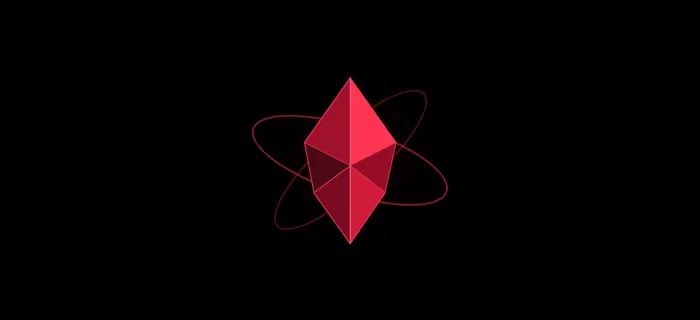

<div align="center">

# U L T R O N

**PERSONAL AI SYSTEM**

*Inteligência artificial para o seu desktop.*



**Windows** &nbsp;·&nbsp; **Python / PyQt6** &nbsp;·&nbsp; **Gemini Live**

[**Download**](https://github.com/Sinisterzs/Ultron/releases) &nbsp;·&nbsp; [**Documentação**](docs/) &nbsp;·&nbsp; [**Código-fonte**](https://github.com/Sinisterzs/Ultron)

</div>

---

## Visão geral

**ULTRON** é um assistente pessoal para Windows com interface holográfica, interação por voz e ferramentas de automação. Construído em Python e PyQt6, é uma evolução personalizada do [MARK LVI, de FatihMakes](https://github.com/FatihMakes/Mark-LVI).

O objetivo é reunir conversação, integrações e controles do desktop em uma experiência única, com identidade visual própria e foco em responsividade.

## Funcionalidades

| Sistema | Recursos |
|:--|:--|
| **Inteligência e voz** | Conversação com Gemini Live, áudio e push-to-talk. |
| **Interface** | HUD holográfico, Crystal Pulse, temas e launcher dedicado. |
| **Automação** | Ferramentas para sistema, arquivos, navegador, busca e mídia. |
| **Integrações** | Spotify com autorização via PKCE, conforme as condições da API. |
| **Memória** | Persistência de informações e dashboard remoto. |
| **Distribuição** | Instalador para Windows x64 e mecanismo integrado de atualização. |

> A disponibilidade de cada recurso depende de credenciais, serviços externos, hardware e permissões. O projeto continua em desenvolvimento.

## Instalação

**Windows x64** · Conexão com a internet necessária na instalação.

1. Acesse a página de [**Releases**](https://github.com/Sinisterzs/Ultron/releases).
2. Baixe o arquivo **`ULTRON-Setup.exe`** da versão desejada.
3. Execute o instalador e siga a configuração inicial.
4. Informe sua **própria chave Gemini** quando solicitada. A configuração do Spotify é opcional.

O instalador prepara um runtime Python privado e instala as dependências; não é necessário instalar Python manualmente. O Chromium usado na automação web é um download opcional e explícito.

**Observações importantes:**

- O instalador ainda **não tem assinatura digital** e pode gerar avisos do Windows.
- A instalação completa em uma máquina Windows limpa ainda precisa ser validada.
- Nenhuma chave pessoal é distribuída com o projeto. Credenciais são protegidas pelo **Windows DPAPI** para a conta local após a configuração; memória e preferências ficam na área de dados do usuário.

## Atualizações

O ULTRON consulta novas versões enquanto está aberto e pode baixar uma atualização verificada. Ao finalizar o download, o usuário escolhe **Reiniciar agora** ou **Depois**.

A instalação anterior é preservada durante a troca para possibilitar restauração em caso de falha. Por isso, é necessário espaço temporário para duas instalações.

> Versões anteriores à **0.1.1** precisam receber o novo instalador manualmente uma vez para habilitar o atualizador. O fluxo completo de atualização entre versões em outro computador ainda precisa ser validado.

## Executar pelo código-fonte

Utilize **Python 3.11–3.13** em um ambiente virtual:

```powershell
python -m venv .venv
.\.venv\Scripts\python.exe -m pip install -r requirements.txt
.\.venv\Scripts\python.exe ultron_entry.py
```

Para habilitar a automação web:

```powershell
.\.venv\Scripts\python.exe -m playwright install chromium
```

Não adicione chaves de API ou dados pessoais ao repositório. Verifique os arquivos antes de qualquer commit, mesmo com as regras do `.gitignore`.

## Desenvolvimento

Execute os testes automatizados:

```powershell
.\.venv\Scripts\python.exe -X utf8 -m unittest discover -s tests -p "test_*.py" -q
```

Os testes utilizam mocks e dados fictícios; **não garantem** conectividade real de todos os serviços ou compatibilidade com todos os ambientes Windows.

Documentação para colaboradores e manutenção:

- [Instruções para agentes e desenvolvedores](AGENTS.md)
- [Instalador: build e armazenamento](installer/README.md)
- [Validação do instalador](installer/VALIDACAO.md)
- [Validação da integração WhatsApp](docs/whatsapp-validation.md)

O instalador pode ser compilado localmente ou por um workflow Windows. O envio de uma tag cria um rascunho de release quando ainda não existe.

## Licença e créditos

ULTRON é derivado do **[MARK LVI de FatihMakes](https://github.com/FatihMakes/Mark-LVI)**. A licença original [**CC BY-NC 4.0**](LICENSE) é preservada, incluindo atribuição e restrição de uso comercial. A publicação do código neste repositório não altera essas condições.

O modelo de face MediaPipe mantém sua atribuição original, indicada nos comentários do projeto e no upstream.

---

<div align="center"><sub>ULTRON · Built on MARK LVI</sub></div>
