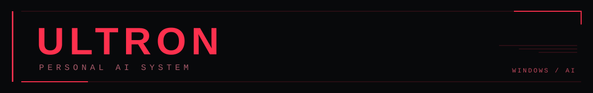

<div align="center">



**A personal AI assistant for Windows.**  
Real-time voice interaction, a holographic interface, and desktop automation.


[**Download**](https://github.com/Sinisterzs/Ultron/releases) · [**Documentation**](docs/) · [**Source Code**](https://github.com/Sinisterzs/Ultron)

</div>

---

## Overview

**ULTRON** is a desktop AI assistant built with **Python and PyQt6**, based on [MARK LVI by FatihMakes](https://github.com/FatihMakes/Mark-LVI). It combines voice conversations, a customizable interface, and integrations with Windows tools and services.

The project is under active development. Some features require your own credentials, system permissions, or external services.

## Features

- **Voice & AI:** Gemini Live conversations with push-to-talk support.
- **Interface:** Holographic HUD, themes, and animations.
- **Automation:** Integrations with the operating system, files, browser, and media.
- **Extensions:** Plugins and optional Spotify integration using PKCE.
- **Memory:** Persistent information and a remote dashboard.
- **Updates:** In-app update checks and downloads, with confirmation before restarting.

## Installation

Download **`ULTRON-Setup.exe`** from the [Releases](https://github.com/Sinisterzs/Ultron/releases) page.

The installer sets up a private Python runtime and the required dependencies. **An internet connection is required**, but you do not need to install Python manually. Downloading Chromium for browser automation is optional.

> **Current status:** The installer is not digitally signed. Installation on a clean Windows system and the complete update process on a different computer still need validation.

Each user provides their own Gemini API key and may optionally configure Spotify. Credentials are protected using **Windows DPAPI** for the local user account; they are not bundled with the project. Memory and preferences are stored in the user's data directory, outside the installation folder.

**Updates:** Installations earlier than version `0.1.1` must run the latest Setup once to enable the updater. The update process preserves the previous installation during replacement, so additional temporary disk space is required.

## Run from Source

Requires **Windows** and **Python 3.11–3.13**:

```powershell
python -m venv .venv
.\.venv\Scripts\python.exe -m pip install -r requirements.txt
.\.venv\Scripts\python.exe ultron_entry.py
```

To enable optional browser automation:

```powershell
.\.venv\Scripts\python.exe -m playwright install chromium
```

Never commit API keys or local configuration files to GitHub.

## Development

```powershell
.\.venv\Scripts\python.exe -X utf8 -m unittest discover -s tests -p "test_*.py" -q
```

Tests use mocks and sample data; they do not establish real connectivity with every external service.

Further reading: [AGENTS.md](AGENTS.md) · [Installer](installer/README.md) · [Installer Validation](installer/VALIDACAO.md) · [WhatsApp Validation](docs/whatsapp-validation.md)

## License & Credits

Derived from **[MARK LVI](https://github.com/FatihMakes/Mark-LVI)** by **FatihMakes**. The original **[CC BY-NC 4.0 license](LICENSE)** is retained, including attribution and non-commercial restrictions. Publishing the code does not change those terms. The MediaPipe face model retains its original attribution, as noted in the source comments and upstream project.

---

<div align="center">
  <sub>ULTRON · PERSONAL AI SYSTEM</sub>
</div>
