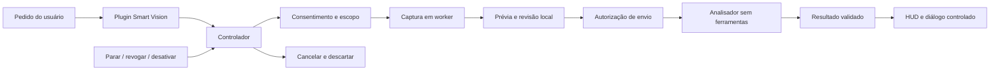

# ULTRON — Smart Vision

Auditoria de arquitetura e plano técnico de implementação.

Data da auditoria: **31/10/2026**.

**Status: planejamento. Nenhuma implementação do Smart Vision foi realizada nesta etapa. A implementação depende de aprovação explícita.**

## 1. Resumo executivo

O Smart Vision pode aproveitar a captura e os provedores existentes, mas precisa de novos controles de permissão, ciclo de vida e isolamento.

O ULTRON já possui visão sob demanda integrada à conversa, captura de webcam, prévia de câmera e identificação visual de elementos. Entretanto, essas capacidades estão distribuídas entre o núcleo, a interface e ações de automação. Não existe hoje um plugin Smart Vision com os controles solicitados.

**Recomendação:** implementar um plugin com análise isolada de uma imagem, sem ferramentas de execução, mantendo o modelo principal de voz. Reutilizar bibliotecas, armazenamento de preferências, roteamento de modelos e comunicação com o Qt, com adaptações pequenas e explícitas nos contratos do host.

Os pontos prioritários são:

- Separar autorização para capturar da autorização para transmitir.
- Impedir que o fallback de modelos envie imagens a um destino não autorizado.
- Dar à webcam um único proprietário.
- Cancelar operações ao revogar permissões, desativar o plugin ou encerrar o aplicativo.
- Tratar textos extraídos das imagens como conteúdo não confiável.
- Impedir que uma consulta visual dispare cliques, alterações de arquivos ou mensagens.
- Evitar que descrições sensíveis entrem automaticamente na memória persistente.

**Escopo da auditoria:** leitura de código, contratos, testes existentes, metadados das dependências e documentação técnica oficial. Durante a auditoria, nenhum arquivo foi alterado; não foi iniciada a aplicação, não houve captura de tela/webcam, consultas a modelos, execução de testes ou instalações. O Git permaneceu sem alterações. Este documento foi criado posteriormente, a pedido do usuário, para registrar o relatório.

Neste relatório, **confirmado** significa verificado na implementação; **inferência** indica uma consequência provável ainda sem reprodução; **proposta** descreve trabalho futuro. Referências de linha correspondem ao código inspecionado nessa data e podem mudar com futuras alterações.

## 2. Inventário do sistema visual atual

Há componentes reutilizáveis, mas nenhum atende sozinho ao escopo completo.

| Capacidade e referência | Comportamento confirmado | Reutilização, limitações e adaptação |
|---|---|---|
| Tela — `actions/screen_processor.py:95`, `_capture_screen()` | Usa `mss`, seleciona `monitors[1]` quando disponível, captura pixels e devolve imagem comprimida em memória. | Reutilizar backend. Acrescentar seleção explícita de monitor/região. Atualmente não recebe janela ou coordenadas e não captura todos os monitores por padrão. |
| Compressão — `actions/screen_processor.py:80`, `_compress()` | Pillow converte para RGB, limita a 1280×720 e gera JPEG com qualidade 82. Se houver falha, retorna o original. | Reutilizar processamento. Precisará de limite obrigatório de pixels/bytes e perfis para texto versus fotografia. O fallback atual pode devolver uma imagem maior que o esperado. |
| Foto da webcam — `actions/screen_processor.py:161`, `_capture_camera()` | Abre OpenCV, aquece com dez leituras, obtém um quadro e libera a câmera no caminho normal. | Reutilizar conversão e escolha de backend. Falta `finally` abrangente para liberação, cancelamento e política de autorização. |
| Descoberta de webcam — `actions/screen_processor.py:138`, `_detect_camera_index()` | Testa índices 0–5, avalia luminosidade média e salva o índice escolhido. | Essa sondagem abre dispositivos. Deve ocorrer somente após consentimento; imagem escura não comprova câmera inválida. Evitar troca silenciosa para outra webcam. |
| Ferramenta visual — `main.py:1393`, `JarvisLive._execute_tool()` | `screen_process` captura em executor, usa cooldown de quatro segundos, registra uma imagem pendente e inicia prévia quando a origem é câmera. | Reutilizar intenção e proteção contra duplicatas. Não foi encontrada autorização humana nessa rota. O estado precisa deixar de depender apenas de flags globais da sessão. |
| Envio para conversa — `main.py:1651`, `_flush_pending_vision()` | Envia imagem em base64 e pergunta como turno de usuário, após a resposta da ferramenta. Identifica tela versus webcam. | Reutilizável como adaptador opcional. A imagem passa a integrar o contexto da conversa; não existe remoção individual implementada nem permissão por destino. |
| Prévia contínua — `ui.py:5831`, `MainWindow.start_camera_stream()` / `_cam_loop()` | Abre novamente a webcam, lê em thread daemon, codifica JPEG e emite frames após esperas de 33 ms. | É prévia local, **não transmissão contínua ao modelo**. Deve ser substituída por um consumidor do mesmo serviço de câmera. Não guarda a thread para aguardar encerramento e não impede múltiplos starts. |
| Fechamento da câmera — `main.py:1429`, `close_camera`; `ui.py:5871`, `stop_camera_stream()` | Sinaliza um `threading.Event`; não aguarda confirmação de liberação. Outra rota agenda parada dois segundos após `turn_complete`. | Preservar comando e botão de parada. Precisam cancelar também captura, envio pendente e resultados atrasados. A descrição da ferramenta promete câmera aberta até solicitação, mas o código implementa fechamento automático. |
| Miniatura — `ui.py:1578`, `_CameraPreview` | Existe overlay com imagem e ocultação temporizada; `JarvisUI.show_camera_frame()` fornece acesso por sinal. | Pode inspirar a revisão da última captura. A rota atual de `screen_process` usa a prévia grande, não esse overlay. O novo componente não deve herdar um timer de animação independente. |
| Captura para arquivo — `actions/computer_control.py:264`, `_screenshot()` | Captura via PyAutoGUI e grava PNG. | Adequada para exportação explícita; não reutilizar como transporte interno do Smart Vision, que deve manter imagens em memória. |
| Localizar e clicar — `actions/computer_control.py:462`, `_screen_find()` | Captura tela, consulta `core.gemini` e interpreta coordenadas. `screen_click` clica após localizar. | Há automação visual existente. Não comprova sucesso do clique nem deve ser chamada pelo MVP. Precisa entrar no controle das rotas que podem contornar permissões. |
| Depuração visual — `actions/code_helper.py:445`, `_screen_debug_action()` | Grava screenshot temporário no Desktop, analisa com modelo e pode salvar código retornado no arquivo informado. | Reutilizar apenas ideias de descrição de erros. Não encaminhar perguntas de observação para essa ação: ela pode produzir alterações. A saída antecipada sem resposta do modelo também pode deixar o screenshot gravado. |
| Screenshot do navegador — `actions/browser_control.py:993`, `_BrowserSession.screenshot()` | Playwright captura a página controlada e grava arquivo. | Útil futuramente para inspeção específica do navegador. Não equivale à captura de qualquer janela desktop nem fornece o fluxo de consentimento proposto. |
| Captura pelo sistema — `actions/computer_settings.py:498`, `take_screenshot()` | No Windows aciona `Win+Shift+S`; outras plataformas usam seus próprios caminhos. | Preservar como comando do sistema. Não retorna uma imagem pronta para análise. |

Também existem capturas regionais e uso de UI Automation em `actions/game_updater.py:196`, além de automação específica do WhatsApp. São implementações especializadas, não uma infraestrutura geral de percepção visual.

## 3. Arquitetura existente e pontos de integração

A independência do plugin exige uma pequena extensão do host.

O contrato real de plugins está em `core/plugin_loader.py`:

- Descobre arquivos diretamente em `plugins/*.py`; ignora nomes iniciados por `_`.
- Exige `PLUGIN` e uma função `run(parameters, ...)`.
- Rejeita colisões com ferramentas internas, ações e outros plugins.
- Encaminha `player` e `session_memory` quando a assinatura aceita. Atualmente `session_memory` é passado como `None`.
- Executa `run()` de forma síncrona; o chamador em `main.py` usa executor.
- Relê habilitação ao listar declarações e executar.
- Não possui contrato de inicialização de recursos, desativação, cancelamento ou encerramento.

**Confirmado:** plugins ficam habilitados por padrão, conforme `memory/config_manager.py:372`, `get_plugin_enabled()`. Desativar na interface salva uma preferência, mas não encerra operações já iniciadas.

**Consequência:** habilitação do plugin não pode significar autorização de câmera ou tela. Além disso, adicionar um `async def run()` não funciona automaticamente: o loader atual não aguarda corrotinas.

Há uma distinção importante de concorrência: o executor evita bloquear o Qt, porém `main.py:1813`, `_receive_audio()`, aguarda `_execute_tool()` durante o processamento das chamadas. **Inferência:** colocar uma análise longa dentro de `run()` pode atrasar o consumo de eventos da sessão, mesmo com a interface responsiva. Declarar `NON_BLOCKING` não transforma esse dispatcher em um gerenciador local de tarefas.

Os pontos de integração recomendados são:

| Área | Contrato existente | Adaptação proposta |
|---|---|---|
| Execução | `PLUGIN` + `run()` em executor | `run()` registra uma operação curta e retorna `ask` ou `started`; trabalho longo tem identificação e encerramento rastreáveis. |
| Ciclo de vida | Registro de plugins durante o processo | Hooks opcionais de criação e fechamento de runtime, preservando plugins antigos. |
| UI | `JarvisUI` encaminha várias operações por sinais | Ponte pequena para solicitar consentimento, publicar estado, mostrar prévia e parar. |
| Modelos | `core.gemini`, `providers.registry`, capacidades | Política explícita de destino, suporte visual, deadline total e cancelamento. |
| Fechamento | `main.py:2827`, `CloseCoordinator`, e `shutdown_services()` | Fechar runtimes de plugins antes de cancelar a sessão e destruir widgets. Não colocar cleanup após um retorno antecipado do dashboard. |
| Compatibilidade | `screen_process` e `close_camera` são ferramentas internas | Delegação para o serviço autorizado, evitando duplicar declarações equivalentes. |

Existe ainda uma rota `shutdown_jarvis` que usa `os._exit(0)` em `main.py:1450`. Ela precisa ser considerada no ciclo de vida da câmera; não se deve assumir que todos os encerramentos atuais passam pelo coordenador.

**VOID OS confirmado:** nesta cópia é a linguagem visual e organização da UI PyQt6, com `VoidPrimaryPanel` em `ui_void_panels.py`, submenus e dock. Não foi encontrada uma camada separada de sistema operacional ou um SDK de extensões chamado VOID OS.

## 4. Comparação das alternativas técnicas

Reutilizar infraestrutura não significa reutilizar todas as decisões atuais.

### 4.1 Modelos e análise multimodal

| Abordagem de análise | Vantagens | Limitações | Avaliação |
|---|---|---|---|
| Imagem na sessão principal | Aproveita diálogo, voz e transporte existente; evita uma chamada independente de análise. | Imagem permanece no contexto; sessão tem ferramentas de ação; cancelamento e retenção são mais difíceis de separar. | Alternativa futura, explicitamente autorizada. |
| Análise isolada pela infraestrutura atual | Permite um pedido sem ferramentas, destino delimitado, resultado estruturado e retenção local curta. Mantém o modelo de voz. | Acrescenta uma chamada de análise e exige passagem controlada do resultado para o diálogo. | **Recomendada para o MVP.** |
| Provedores multimodais configuráveis | Aproveita endpoints compatíveis e permite separar voz de visão. | Suporte de imagens, formatos, qualidade e limites variam por modelo/endpoint. | Preparar a interface agora; validar adaptadores progressivamente. |
| Modelo local | Evita envio da imagem a serviço externo quando toda a rota é local. | Consome RAM/CPU/GPU; qualidade de leitura e latência dependem do hardware. | Evolução opcional, sem downloads automáticos. |

O código já declara modelos Live em `core/gemini.py:190` e mantém rotas para consultas independentes. Esses nomes confirmam a configuração do repositório, não disponibilidade, preço ou funcionamento da conta.

O provider `providers/llm_openai.py:403` já transforma imagens em `image_url` e suporta chamadas sem ferramentas. Seu teste `can_see()` envia um PNG de 1×1: **confirma aceitação da requisição, não qualidade de compreensão visual**. Falhas de rede também são convertidas em resultado negativo; a proposta deve distinguir “não suporta” de “não foi possível verificar”.

O template orienta a usar `core.gemini`, e isso deve ser preservado. Contudo, `core/gemini.py:656`, `gemini.call()`, acrescenta fallbacks até quando recebe um modelo explícito. Portanto, **o Smart Vision não pode chamar esse método sem uma extensão que restrinja destinos autorizados**. O prazo atual por tentativa também não substitui um deadline total para toda a operação.

A documentação oficial diferencia envio de frames em tempo real e conteúdo de contexto. Isso reforça a necessidade de validar o adaptador com o modelo selecionado, sem transformar o MVP em streaming ou trocar o modelo de voz. Fonte: [Documentação Gemini Live](https://ai.google.dev/gemini-api/docs/live-api/capabilities).

### 4.2 Tecnologias de captura

| Tecnologia | Uso recomendado |
|---|---|
| `mss` + Pillow | Tela e região sob demanda. Já estão presentes; processar pixels diretamente evita PNG intermediário seguido de decodificação e JPEG. |
| Geometria Win32 + `mss` | Recorte da área visível ocupada por uma janela, com limitação explícita: pode incluir o que estiver sobre ela. |
| Windows Graphics Capture | Investigar para captura real de janela, usando seleção do sistema e indicação nativa. Exige integração WinRT/Direct3D e validação do empacotamento. |
| `PrintWindow` | Não escolher como solução padrão: é síncrono e depende da aplicação alvo. |
| OpenCV | Webcam, com abertura tardia, proprietário único e controle de liberação. |
| OCR/modelos adicionais | Fora do MVP; só adicionar se a avaliação de leitura justificar. |

As distinções são sustentadas pela documentação de [MSS](https://python-mss.readthedocs.io/latest/examples.html), [Windows Graphics Capture](https://learn.microsoft.com/en-us/windows/apps/develop/media-authoring-processing/screen-capture) e [PrintWindow](https://learn.microsoft.com/en-us/windows/win32/api/winuser/nf-winuser-printwindow).

**Decisão de escopo:** entregar tela/região primeiro. Uma opção chamada “janela” só deve prometer isolamento da janela após validar um backend que realmente ofereça essa propriedade.

## 5. Arquitetura recomendada

Plugin funcional com helpers privados e uma ponte pequena com o aplicativo.

Não é recomendado criar sete classes apenas para reproduzir os nomes conceituais. O ponto de entrada deve seguir o contrato real; o controlador concentra coordenação, enquanto captura, análise e permissões ficam separados.

Todos os arquivos abaixo são **propostas; não foram criados**. Caminhos relativos à raiz do repositório:

| Arquivo proposto | Responsabilidade |
|---|---|
| `plugins/smart_vision.py` | `PLUGIN`, `PLUGIN_SETTINGS`, validação de parâmetros e `run()`. |
| `plugins/_smart_vision_controller.py` | Operações, estados, exclusão mútua, cancelamento e publicação de resultados. |
| `plugins/_smart_vision_capture.py` | Captura de monitor/região, transformação de coordenadas, compressão e metadados. |
| `plugins/_smart_vision_permissions.py` | Autorizações efêmeras, escopo, validade e revogação. |
| `plugins/_smart_vision_analyzer.py` | Adaptadores multimodais, destino autorizado e validação da resposta. |
| `plugins/_smart_vision_camera.py` | Proprietário único da webcam, adicionado na fase 2. |
| `plugins/_smart_vision_context.py` | Contexto temporário limitado, adicionado na fase 3. |
| `core/plugin_runtime.py` | Contrato genérico mínimo de runtime, tarefas e comunicação com o host. |
| `ui_vision.py` | Consentimento, seleção, indicador e prévia sob demanda. |

Os helpers com `_` respeitam a descoberta atual. A organização plana também combina com a allowlist existente; subpacotes não entram automaticamente.

A extensão do loader pode aceitar, opcionalmente, `create_runtime(context)` e um runtime com fechamento idempotente. `run()` receberia esse runtime somente quando sua assinatura o declarar. Plugins antigos continuariam recebendo os argumentos atuais.

O contexto do host deve expor apenas serviços delimitados: agendar trabalho, solicitar consentimento, emitir eventos, consultar capacidades e entregar resultado. O plugin não precisa acessar `player._win`, criar outro `QApplication` ou possuir a sessão principal.

Contratos de dados mínimos:

- **Pedido:** identificador, pergunta, origem, alvo, prazo e geração da sessão.
- **Captura:** identificador, bytes, MIME, dimensões, instante, recorte e transformação de coordenadas.
- **Autorização:** origem/alvo permitido, captura aprovada, destino, finalidade e expiração.
- **Resultado:** observações visuais, inferências, incertezas, limitações e referência da captura.
- **Estado:** origem, etapa, operação ativa e condição real de liberação dos recursos.

Uma observação produzida pelo modelo continua sendo interpretação. `done` deve confirmar que a captura/análise terminou, não certificar que todo texto reconhecido ou conclusão visual é verdadeiro.

## 6. Fluxo de dados e permissões

Consentimento precisa acompanhar a operação inteira.

O fluxo recomendado é:

1. O pedido verbal/textual solicita a função; parâmetros do modelo nunca concedem permissão.
2. A interface apresenta a origem e o alvo. A primeira autorização permite captura local.
3. Um indicador aparece antes de obter pixels ou abrir a webcam.
4. O worker captura somente o escopo aprovado.
5. A prévia permite revisar, recortar, ocultar áreas e cancelar.
6. A interface identifica o provedor de destino e pede autorização para enviar aquela imagem.
7. O controlador revalida autorização e cancelamento imediatamente antes da transmissão.
8. O analisador recebe imagem e contexto mínimo, sem ferramentas de ação.
9. O resultado é validado e apresentado; bytes e referências temporárias são descartados conforme a política aprovada.

**Proposta de padrão:** autorizações por operação, separadas para tela, câmera e envio. Preferências podem persistir; concessões de acesso não devem reaparecer automaticamente após reiniciar.

Uma concessão deve ficar vinculada à revisão exata da captura. Alterar recorte, obter outro frame ou mudar o endpoint invalida a aprovação anterior. Falha de provedor não autoriza encaminhamento automático a outro destino.

Revogação deve bloquear novos trabalhos, invalidar operações pendentes e descartar respostas tardias. Não é possível retirar bytes já transmitidos; a interface precisa diferenciar “envio cancelado antes de iniciar” de “pedido já enviado, processamento local cancelado”.

A proteção de conteúdo sensível deve privilegiar seleção restrita e ocultação manual. Não propor detecção automática de senhas como garantia: tokens podem aparecer em texto comum, imagens e notificações.

### 6.1 Retenção de imagens e texto

Para retenção, a recomendação inicial é:

- Uma captura autorizada em memória, com limite de tamanho e expiração curta.
- Nenhum arquivo temporário de imagem no fluxo normal.
- “Última captura” disponível apenas dentro desse prazo.
- Limpeza em revogação, desativação, encerramento e mudança de sessão.
- Logs com estado, duração, dimensões e erro sanitizado; sem pixels, base64, texto reconhecido ou títulos sensíveis.

**Retenção de texto também importa.** As respostas atuais entram em `_session_log`, podem alimentar resumo persistente e são transmitidas ao dashboard quando conectado. Isso está em `main.py:1792`, `_receive_audio()`, e `main.py:2101`, `_save_session_summary()`. O resultado visual precisa carregar origem e política de retenção, incluindo derivações em respostas posteriores. Uma visão local com resumo enviado ao modelo de voz externo também não é uma operação inteiramente local.

### 6.2 Conteúdo não confiável e separação de ações

Para conteúdo malicioso, reaproveitar `core/outcome.py:188`, `untrusted()`, e as regras já presentes no prompt, acrescentando:

- Analisador sem declarações de ferramentas.
- Resposta validada contra estrutura e tamanho limitados.
- Conteúdo reconhecido tratado como dados.
- Nenhum código, URL ou comando retornado executado automaticamente.
- Bloqueio no dispatcher de ações derivadas do turno visual, até existir um novo pedido humano independente.

Esse bloqueio precisa ser efetivo no código. Só acrescentar “não execute” ao prompt não satisfaz a separação entre observar, sugerir e agir.

O banner existente de `core/confirm.py:73` oferece um padrão útil de confirmação emitida pela UI. Porém, mantém apenas uma pendência global e foi desenhado para ações irreversíveis. Não deve receber autorizações de visão indiscriminadamente, substituindo outras confirmações.

## 7. Plano incremental de implementação

Os controles mínimos de segurança entram antes do acabamento visual.

A fase 4 pode concentrar o acabamento do HUD, mas consentimento, indicador e botão de parada são requisitos já das fases 1 e 2.

| Fase | Objetivo e arquivos envolvidos | Dependências, riscos e desempenho | Aceitação e testes | Complexidade |
|---|---|---|---|---|
| **0 — Auditoria e contratos** | Esta auditoria cobre o mapeamento estático. Próximo passo autorizado: especificar contratos do runtime, compatibilidade de ferramentas e matriz de dados. Envolve os loaders, `main.py`, UI, captura e provedores citados. | Sem dependências novas. Risco principal: confundir existência de código com funcionamento. Sem carga de captura nesta etapa. | Aprovar limites de janela, retenção, destinos e cancelamento. Preparar fixtures sintéticas e baselines antes de qualquer teste real. Hardware, serviços e FPS continuam não validados. | **Baixa/média.** |
| **1 — MVP Screen Vision** | Criar entrada do plugin, controlador, captura, permissões, analisador, ponte de runtime e UI mínima. Adaptar `screen_process`, roteador e rotas de captura concorrentes. | MSS, Pillow, Qt e SDK/HTTP existentes. Riscos: DPI, janela coberta, fallback externo, bloqueio do recebimento da voz. Custo local limitado a uma captura e codificação por pedido. | Tela/monitor e região selecionáveis; captura e envio separados; cancelar antes do envio produz zero requisições; nenhuma imagem gravada; nenhuma ação executada. Testes de permissões, destinos, imagens inválidas, chamadas duplicadas e erro do provedor; validação manual com conteúdo fictício. Janela isolada é um incremento condicionado ao backend. | **Alta**, pelos contratos e privacidade. |
| **2 — Camera Vision** | Adicionar provider de câmera; adaptar prévia, `close_camera` e encerramento. Um único proprietário atende foto e eventual prévia. | OpenCV existente; processo auxiliar da biblioteca padrão se necessário para conter bloqueios nativos. Riscos: driver travado, disputa de dispositivo, troca de câmera e callbacks tardios. Câmera desligada deve ter zero leituras. | Autorização antes de abrir ou sondar; câmera escolhida sem fallback silencioso; parada disponível durante análise; liberação confirmada antes de indicar desligamento. Mocks verificam release em falhas; teste manual cobre desconexão, dispositivo ocupado, stop/start rápido e fechamento do app. | **Alta.** |
| **3 — Contexto visual** | Adicionar contexto temporário e adaptar entrega ao diálogo, resumo de sessão e broadcast. | Sem dependência nova. Riscos: resultados obsoletos, persistência indireta e duplicação de fala. Memória limitada por quantidade, bytes e prazo. | Perguntas complementares usam apenas captura ainda válida; nova captura não reutiliza autorização antiga; conteúdo visual não entra em resumo/dashboard sem política explícita. Testes de expiração, reconexão, respostas fora de ordem e uma única entrega. | **Média/alta.** |
| **4 — HUD Integration** | Refinar `ui_vision`, integração com UI, configurações, chat e painéis VOID OS; incluir módulo na allowlist. | PyQt6 existente. Riscos: sobreposição, foco, caches e controles ocultos fora da Home. Repintura por mudança de estado; animação opcional na cadência existente. | Estados e parada acessíveis nas páginas, modo janela/maximizado e vídeo; cristal preservado; prévia voluntária. Testes Qt offscreen, inspeção real em diferentes DPI e comparação de diagnóstico de cadência. | **Média.** |
| **5 — Desktop Integration futura** | Planejamento de ações supervisionadas usando ações existentes, `core.confirm`, `core.undo` e evidência posterior. Fora do MVP. | Priorizar UI Automation/DOM onde disponíveis; coordenadas visuais como alternativa delimitada. Riscos: alvo mudou, ação destrutiva, prompt injection e falso sucesso. Nova captura apenas para validação autorizada. | Mostrar plano/alvo, confirmar operações sensíveis, revalidar identidade e geometria e verificar resultado. Testes em aplicações fictícias, incluindo falha parcial e `unverified`; nenhum envio real como teste. | **Muito alta; aprovação separada.** |

### 7.1 Integração visual com VOID OS

A integração de UI recomendada é um indicador compacto com `VISION OFF`, `SCREEN`, `CAMERA` e `ANALYZING`, acompanhado de texto explicativo quando necessário. “OFF” deve significar ausência de captura ativa; autorização e estado do dispositivo precisam continuar distinguíveis internamente.

O indicador não deve depender exclusivamente do `CoreStatusPanel`, em `ui_core_status.py`, pois ele é transparente ao mouse e se oculta fora da página do HUD. Controles podem ficar no submenu existente; durante captura, parada precisa permanecer acessível mesmo fora da Home. Ao minimizar o app, a opção inicial mais simples é interromper a captura, evitando atividade sem indicação visível.

Preservar a estética vermelho/preto, o cristal central e a cadência compartilhada do HUD. Evitar painéis permanentes desnecessários e oferecer a última captura apenas sob demanda e dentro do prazo de retenção aprovado.

## 8. Riscos, dependências e regressões

Os maiores riscos estão nos caminhos paralelos e no cancelamento.

| Risco | Evidência ou consequência | Tratamento proposto |
|---|---|---|
| Contornar permissões | Captura existe também em `screen_find`, `screen_click`, depuração e ações especializadas. | Inventariar e proteger entradas relevantes com a mesma política; não anunciar “bloqueio global” enquanto houver rotas alternativas. |
| Confundir desativação com encerramento | Toggle atual apenas salva configuração. | Evento explícito de desativação, fechamento idempotente e nova checagem antes de capturar/enviar. |
| Travar voz sem travar UI | Receiver aguarda execução das ferramentas. | Operações registradas de curta duração e entrega posterior rastreável; medir também áudio. |
| Webcam aberta mais de uma vez | Captura e prévia criam `VideoCapture` separadamente. | Proprietário único, start idempotente e parada associada à geração correta. |
| Estado ocupado permanente | Flags de visão não são restauradas em todos os caminhos de falha da captura. | Máquina de estados com cleanup em `finally`. |
| Confirmação incorreta de parada | `stop_camera_stream()` apenas sinaliza um evento. | Diferenciar solicitação de parada de liberação concluída. |
| Vazamento de imagem ou descrição | Fallback de modelos, resumo da conversa, dashboard e arquivos temporários. | Destinos permitidos e política de retenção propagados junto ao resultado. |
| Regressão da UI | Prévia atual substitui o cristal e afeta chat/vídeo. | Prévia sob demanda em componente próprio e testes de convivência. |
| Plugin incompleto no pacote | Allowlist inclui `*.py` diretamente, não subárvores arbitrárias. | Helpers planos; entrada explícita para `ui_vision.py`; verificar manifesto sem gerar Setup. |
| Limitação da política interna | Plugins são Python executado no processo, sem sandbox. | A política controla componentes cooperativos; não constitui isolamento contra plugin malicioso. |

Foi confirmada por metadados do `.venv` a presença de Python 3.11.0, PyQt6, `google-genai`, MSS, OpenCV, Pillow, NumPy, HTTPX, PyWin32, PyGetWindow e pywinauto. Isso não comprova abertura de dispositivo, carregamento de DLLs ou conectividade.

**Não há necessidade demonstrada de nova dependência pesada no MVP.**

### 8.1 Eficiência e parâmetros iniciais

Para desempenho, os parâmetros iniciais propostos, ainda a validar, são:

- Uma análise em andamento; sem fila ilimitada.
- Nenhuma captura periódica de tela.
- Uma imagem enviada por solicitação.
- Perfil fotográfico próximo do limite atual; perfil de texto com recorte e resolução ajustável.
- Limites explícitos de pixels e bytes antes do envio.
- Uma miniatura e uma captura autorizada retidas, com expiração.
- Se houver prévia de câmera, começar com 5–10 FPS locais, sem transmissão automática.
- Rejeitar resultados de sessões ou autorizações vencidas.

O Qt deve receber somente eventos e imagens prontas; criação/atualização de widgets permanece na thread principal. Fonte: [Contrato de threads do Qt](https://doc.qt.io/qt-6/threads-qobject.html).

**Cancelar uma future não interrompe automaticamente uma leitura nativa bloqueada.** Os timeouts de leitura documentados pelo OpenCV não são universais para todos os backends. Para exigir prazo de encerramento do worker, considerar processo dedicado de câmera; não prometer prazo físico do LED com base apenas em um `Event`. Fonte: [Limitações de timeout do OpenCV](https://docs.opencv.org/4.12.0/d4/d15/group__videoio__flags__base.html).

## 9. Estratégia de testes

Verificar contratos sem capturar dados pessoais.

A suíte futura deve usar imagens sintéticas, transportes falsos, relógio controlável e configuração temporária. Não importar `main.py` ou `ui.py` para testes simples; os widgets existentes já oferecem exemplos de isolamento por AST/offscreen.

Os grupos essenciais são:

- **Permissões:** negar origem/destino; expirar consentimento; revogar durante captura, compressão e envio; rejeitar autorização forjada nos argumentos do modelo.
- **Captura:** monitor secundário, coordenadas negativas, escala 100/150/200%, limites de região, janela movida, imagem vazia, limite de bytes e ausência de arquivo temporário.
- **Modelo:** incapacidade visual, falha transitória, timeout total, resposta inválida, ausência de fallback não autorizado e destino alterado após aprovação.
- **Ciclo de vida:** importação sem abrir dispositivos ou rede; desativação durante trabalho; close repetido; reconexão; descarte de eventos antigos.
- **Câmera:** apenas uma abertura, release em todos os caminhos, parada durante análise e dispositivo indisponível.
- **Segurança:** screenshot com instruções maliciosas não produz clique, escrita, mensagem, abertura de URL ou chamada adicional.
- **Retenção:** nenhuma imagem/base64 em logs; conteúdo derivado excluído de resumo e broadcast conforme política.
- **UI:** indicador antes da captura, botão de parada acessível, prévia sem modificar cristal, navegação e foco preservados.

Há testes de capacidades e pipeline em `providers/_tests.py:347`, mas não foi identificada uma suíte dedicada que cubra todo o ciclo atual de captura, autorização e câmera.

A validação manual posterior deve usar uma área de teste sem dados pessoais, webcam explicitamente autorizada e o engine escolhido. Medir:

- Captura, compressão, rede e análise separadamente.
- FPS gerado e p95/p99 de intervalos pelo diagnóstico existente.
- CPU, pico de RSS e comportamento após ciclos repetidos.
- Latência de interação e falhas de áudio.
- Tempo entre “Parar” e liberação confirmada do dispositivo.

Como critérios iniciais de desempenho, a sugestão é zero capturas em repouso, nenhuma interrupção de áudio atribuível à visão e ausência de crescimento progressivo de memória. Um limite quantitativo de regressão de cadência deve ser definido após medir o baseline na máquina. Os diagnósticos do HUD não comprovam apresentação física na tela.

## 10. Questões para decisão antes da implementação

| Decisão | Recomendação |
|---|---|
| Modelo de integração | Análise isolada, sem ferramentas, usando infraestrutura existente com destino restrito. |
| Escopo inicial de captura | Monitor e região; janela isolada somente após validar backend nativo. |
| Consentimento | Captura local e envio separados, por operação no primeiro MVP. |
| Retenção | Uma captura temporária, prazo curto configurado; sem gravação permanente. |
| Conversa e memória | Resultado visual efêmero por padrão; não resumir, memorizar ou retransmitir automaticamente. |
| Webcam | Foto sob demanda; prévia persistente apenas por escolha explícita. |
| Comandos antigos | Delegar captura e fechamento ao mesmo serviço autorizado; evitar duas ferramentas equivalentes expostas ao modelo. |
| Falha de modelo | Informar indisponibilidade; novo destino exige nova autorização. |
| UI minimizada | Interromper captura inicialmente, até existir indicador externo adequado. |
| Ações futuras | Pedido humano independente, plano revisável e validação posterior; fora do MVP. |

**A implementação permanece pendente de aprovação explícita. Este arquivo registra a auditoria e o plano; não autoriza instalação, captura real, build, publicação ou automação autônoma.**
